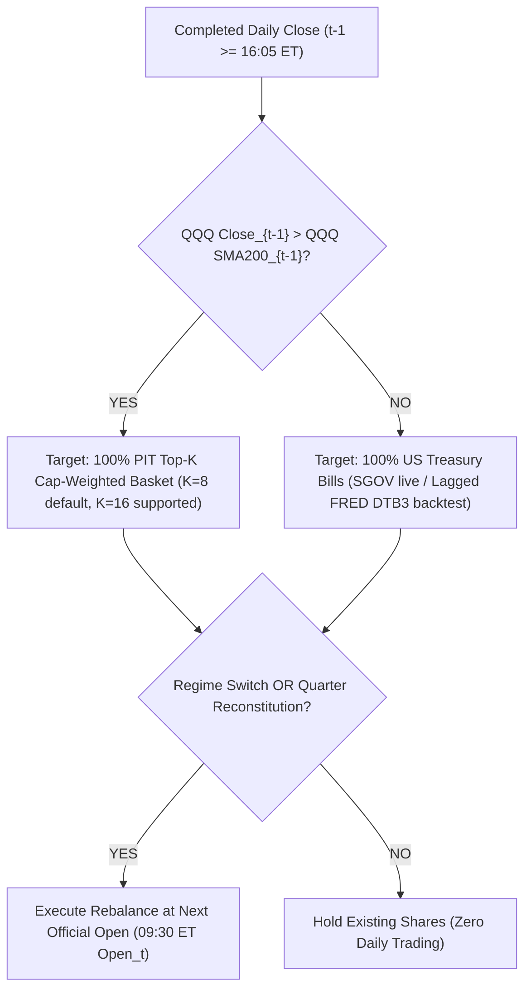

# QQQ Alpha Engine — Point-in-Time Nasdaq-100 Cap-Weight + QQQ 200-Day Moving Average

A minimal, un-fitted equity strategy for the Nasdaq-100 universe: hold the quarterly Point-in-Time (`PIT`) largest `QQQ` constituents weighted by causal SEC EDGAR market capitalization (`Top-8` default; `Top-16` supported) whenever `QQQ` closes above its 200-day simple moving average, and hold 3-month US Treasury Bills otherwise.

---

## 1. Verdict, Weaknesses, and Caveats (Read First)

Over `2016-06-30` to `2026-11-11` (`2,607` trading sessions, `42` quarters), holding the PIT Top-8 cap-weighted basket when `QQQ` is above its 200-day SMA returned `21.81%` annualized CAGR (`\$772,665` from `\$100,000`) with a `-23.50%` maximum drawdown at `10 bps` cost per traded dollar, compared to `20.49%` CAGR (`-35.12%` MaxDD) for Total-Return `QQQ` buy-and-hold.

Before relying on these numbers, note four structural limitations:

1. **Post-selection sample (`2016–2026` is not untouched out-of-sample):** Multiple candidate overlays, factor models, and alternative rules were tested on `2016–2026` before selecting this rule. Its defense against overfitting is structural rather than statistical: market-cap weighting, quarterly reconstitution, a standard 200-day simple moving average, and 3-month Treasury bills use zero fitted parameters.
2. **Flat-MA whipsaw drag and V-bottom re-entry lag:** Binary 200-day moving average switches suffer whipsaws when `QQQ` oscillates near a flat moving average. In the `2026-11-05` to `2026-11-11` episode, `QQQ` closed `-6.49%` down at `\$647.05` below its 200-day SMA (`\$679.61`), exited to T-bills at the `2026-11-06` open, missed rebounds of `+3.54%` (`Nov 9`) and `+2.61%` (`Nov 11`), and re-entered at the `2026-11-12` open. Over the longer `1999–2026` index-only history, `QQQ > 200d SMA` (`7.85%` CAGR) also trailed a `QQQ 20% Volatility-Target` rule (`10.51%` CAGR) due to late re-entry after sharp bear-market bottoms.
3. **Constituent start date and dividend asymmetry:** Point-in-time constituent data begins in `2016-Q2`, so the Top-8 and Top-16 concentration sleeves were not tested during the `2000–2002` dot-com unwind. Cached constituent CSVs (`data/cache/alpaca_sip_daily/*.csv`) are split-adjusted price-only (omitting roughly `0.5%/yr` in cash dividends), whereas the `QQQ` benchmark uses Total-Return `QQQ` and cash uses 1-day-lagged `FRED DTB3`.
4. **Statistical precision of excess returns:** Full-period Newey-West (`maxlags=5`) annualized alpha is `+7.43%` (`t = +1.88`, `p = 0.0606`) for `PIT Top-8 + QQQ 200d MA` vs Total-Return `QQQ` (`+7.14%`, `t = +1.84`, `p = 0.0662` vs Beta-Matched `QQQ`) and `+5.51%` (`t = +1.51`, `p = 0.1322`) for `PIT Top-16 + QQQ 200d MA`. Neither exceeds conventional `p < 0.05` thresholds over 10.3 years.

---

## 2. Plain-Language Strategy Rules

1. **Universe & Dual-Class Deduplication:** At each calendar quarter-end `Q_E` (`Mar 31`, `Jun 30`, `Sep 30`, `Dec 31`), restrict eligibility strictly to verified Nasdaq-100 constituents on `Q_E` via [`config/nasdaq100_pit_membership.json`](config/nasdaq100_pit_membership.json). Non-voting `GOOG` shares are excluded so Alphabet is counted once via `GOOGL`.
2. **Causal Market-Cap Ranking:** Rank eligible constituents descending by `Close(Q_E) * SplitAdj_Shares_filed_on_or_before(Q_E)` using SEC EDGAR XBRL filings with `filed <= Q_E`.
3. **Portfolio Weights & Drift:** Allocate `100%` proportionally by market cap across the top `K` stocks (`K = 8` default; `K = 16` optional broad variant). Reconstitute quarterly at `Open_{t+1}` after `Q_E`; between regime switches, share counts remain fixed so weights drift naturally with market cap (`w_i(t) ~ w_i(Q_E) * Close_i(t) / Close_i(Q_E)`).
4. **Trend Filter & Cash Parking:** At each completed daily close `Close_{t-1}` (after `16:05 ET` live cutoff):
   - If `QQQ Close_{t-1} > QQQ SMA200_{t-1}`: hold `100%` equity basket at `Open_t`.
   - If `QQQ Close_{t-1} <= QQQ SMA200_{t-1}`: hold `100%` US Treasury Bills (`SGOV` live, `BIL` fallback; 1-day-lagged `FRED DTB3` in backtest) at `Open_t`.
5. **No Leverage or Options:** `0% TQQQ`, `0% margin borrowing`, `0% option collars`.



---

## 3. Audited Historical Performance (`2016-06-30` to `2026-11-11`)

Generated by [`scripts/run_backtest.py`](scripts/run_backtest.py) starting from `\$100,000` (`Open_t` execution, pre-warmed 200-day SMA from `1999`, lagged `FRED DTB3` risk-free rate, Newey-West `maxlags=5` HAC `t`-statistics, two-way annualized turnover).

### Full Sample (`2,607` Trading Sessions, `42` Quarters)

| Strategy / Baseline | End `$100k` | CAGR | MaxDD | Sharpe | Beta | Alpha vs QQQ | `t` (QQQ) | Alpha vs Beta-Matched | `t` (BM) | 2-Way Turn | Ex-Best-10d |
| :--- | ---: | ---: | ---: | ---: | ---: | ---: | ---: | ---: | ---: | ---: | ---: |
| `QQQ` Total Return (Buy & Hold) | \$690,297 | 20.49% | -35.12% | 0.84 | 1.00 | 0.00% | — | -0.12% | -0.51 | 0.10x | 12.64% |
| Beta-Matched `QQQ` (`63%` `QQQ` / `37%` `DTB3`) | \$395,612 | 14.19% | -22.93% | 0.84 | 0.63 | +0.09% | +0.64 | 0.00% | — | 0.14x | 9.61% |
| Simple Baseline: `QQQ > 200d SMA` | \$481,810 | 16.38% | -23.35% | 0.84 | 0.58 | +3.33% | +1.05 | +3.05% | +0.99 | 4.05x | 12.05% |
| Simple Baseline: `QQQ` 20% Vol-Target | \$556,460 | 18.01% | -27.82% | 0.89 | 0.75 | +1.66% | +1.08 | +1.48% | +1.02 | 1.42x | 13.68% |
| Ablation: Passive PIT Top-8 (No MA) | \$978,381 | 24.61% | -44.15% | 0.89 | 1.10 | +2.28% | +1.03 | +2.15% | +0.98 | 0.24x | 15.79% |
| Ablation: Passive PIT Top-16 (No MA) | \$839,292 | 22.78% | -42.00% | 0.86 | 1.08 | +0.94% | +0.61 | +0.81% | +0.52 | 0.35x | 14.25% |
| `PIT Top-8 + QQQ 200d MA` (`10 bps`) | \$772,665 | 21.81% | -23.50% | 0.98 | 0.63 | +7.43% | +1.88 | +7.14% | +1.84 | 4.20x | 16.42% |
| `PIT Top-8 + QQQ 200d MA` (`20 bps`) | \$739,750 | 21.30% | -23.80% | 0.96 | 0.63 | +7.01% | +1.76 | +6.71% | +1.72 | 4.20x | 15.93% |
| `PIT Top-8 + QQQ 200d MA` (`30 bps`) | \$708,240 | 20.79% | -24.39% | 0.94 | 0.63 | +6.58% | +1.65 | +6.29% | +1.61 | 4.19x | 15.45% |
| `PIT Top-16 + QQQ 200d MA` (`10 bps`) | \$633,798 | 19.50% | -23.13% | 0.91 | 0.62 | +5.51% | +1.51 | +5.21% | +1.46 | 4.28x | 14.55% |
| `PIT Top-16 + QQQ 200d MA` (`20 bps`) | \$606,266 | 18.99% | -23.98% | 0.89 | 0.62 | +5.07% | +1.38 | +4.78% | +1.33 | 4.28x | 14.06% |
| `PIT Top-16 + QQQ 200d MA` (`30 bps`) | \$579,932 | 18.48% | -25.04% | 0.87 | 0.63 | +4.64% | +1.26 | +4.35% | +1.20 | 4.28x | 13.57% |

### Subperiod Split (`2016–2021` vs `2022–2026`, `10 bps`)

| Strategy | `2016–2021` CAGR | `2016–2021` MaxDD | `2016–2021` Sharpe | `2022–2026` CAGR | `2022–2026` MaxDD | `2022–2026` Sharpe |
| :--- | ---: | ---: | ---: | ---: | ---: | ---: |
| `QQQ` Total Return (Buy & Hold) | 27.79% | -28.56% | 1.20 | 12.53% | -34.83% | 0.45 |
| Simple Baseline: `QQQ > 200d SMA` | 20.98% | -23.35% | 1.10 | 11.19% | -19.90% | 0.50 |
| Simple Baseline: `QQQ` 20% Vol-Target | 23.04% | -18.57% | 1.28 | 12.41% | -26.79% | 0.51 |
| Ablation: Passive PIT Top-8 | 33.51% | -27.00% | 1.28 | 14.76% | -44.14% | 0.50 |
| `PIT Top-8 + QQQ 200d MA` (`10 bps`) | 26.73% | -23.50% | 1.22 | 15.97% | -20.05% | 0.67 |
| `PIT Top-16 + QQQ 200d MA` (`10 bps`) | 23.89% | -23.13% | 1.14 | 14.31% | -20.05% | 0.61 |

Additional component ablation and rejection tests (legacy factor gates, TQQQ overlay, Black-Scholes collars, and intraday SIP buy/sell flow features) are documented in [`docs/Empirical_Audit_and_Ablation_Notes.md`](docs/Empirical_Audit_and_Ablation_Notes.md), and the full operational spec is in [`docs/Strategy_Specification.md`](docs/Strategy_Specification.md).

---

## 4. Repository Structure & Quickstart

```text
qqq_alpha_engine/
├── .env.example                            # Template for Alpaca SIP keys & SEC User-Agent
├── app.py                                  # Standalone Streamlit audit & live signal terminal
├── pyproject.toml
├── requirements.txt
├── config/
│   ├── nasdaq100_pit_membership.json       # Multi-interval PIT Nasdaq-100 constituent ledger
│   ├── strategy_config.yaml                # Strategy v5.0.0 parameters
│   └── universe_qqq.json                   # Deduplicated active constituent cap-weight snapshot
├── data/
│   ├── point_in_time_rosters.csv           # 42-quarter PIT Top-16 rosters (672 rows)
│   ├── cache/
│   │   ├── qqq_total_return_1999_2026.csv  # Pre-warmed Total-Return QQQ bar series
│   │   ├── alpaca_sip_daily/               # Cached split-adjusted daily bars (204 symbols)
│   │   └── fred_macro/DTB3.csv             # 3-month Treasury Bill secondary market rate
│   └── outputs/
│       ├── daily_nav_ledger.csv            # Daily strategy and baseline NAV curves
│       ├── quarterly_performance_ledger.csv# 42-quarter comparison table
│       ├── production_audit_summary.json   # Full, subperiod, cost sensitivity, and recent log
│       └── production_daily_signals.json   # Latest completed-close live order tickets
├── docs/
│   ├── Empirical_Audit_and_Ablation_Notes.md
│   └── Strategy_Specification.md
├── scripts/
│   ├── rebuild_pit_rosters.py              # Rebuilds PIT rosters from SEC XBRL filings + SIP bars
│   ├── run_backtest.py                     # Runs Open_t share-level backtest and generates ledgers
│   └── run_production_daily.py             # Generates daily close signal & next-open order tickets
├── src/
│   ├── clients/
│   │   ├── alpaca_client.py                # Daily bars and snapshots client
│   │   └── sec_edgar_client.py             # Point-in-time SEC XBRL share-count client
│   └── ui/
│       └── terminal.py                     # Interactive Plotly + Streamlit dashboard renderer
└── tests/
    └── test_production_pit_ma200.py        # Integrity, warmup, cost monotonicity, and causality tests
```

### Setup & Verification Commands

```bash
pip install -r requirements.txt
cp .env.example .env   # Optional: add APCA_API_KEY_ID / APCA_API_SECRET_KEY for live SIP updates

# 1. Run automated integrity & causality tests
python -m pytest tests/test_production_pit_ma200.py -v

# 2. Reproduce full audit ledgers (runs offline using cached data/)
python scripts/run_backtest.py

# 3. Generate live daily signal & next-open ticket list (--top-k 8 or --top-k 16)
python scripts/run_production_daily.py --capital 100000 --top-k 8

# 4. Optional: rebuild 42-quarter PIT rosters (pass --offline to skip data.sec.gov fetches)
python scripts/rebuild_pit_rosters.py --offline

# 5. Launch the interactive audit and signal terminal
python -m streamlit run app.py --server.port 8501 --server.headless true
```
